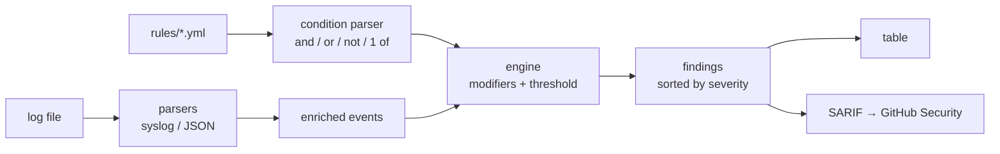

# siglint

[](https://github.com/a0merr/siglint/actions/workflows/ci.yml)


**Scan logs against Sigma-style detection rules and emit SARIF** — a small, dependency-light detection engine for the blue-team side of the house. Point it at an `auth.log`, write rules in YAML, get findings on the terminal or straight into GitHub's **Security** tab.

Built by a [Sigma](https://github.com/SigmaHQ/sigma) contributor — same detection-as-code idea, shrunk to a single CLI you can run in CI. It speaks real Sigma detection syntax: **3,136 of 3,161 SigmaHQ rules (99.2%) load and validate** — full `condition` expressions, wildcards, and the common modifiers.

## Demo (30 seconds)


```console
$ siglint scan examples/auth.log -r rules
6 finding(s) in examples/auth.log:

LEVEL  RULE                            COUNT  WHERE / LINE
----------------------------------------------------------------------------
CRIT   suspicious_download_pipe_shell      1  line 10
CRIT   uid0_account_created                1  line 9
HIGH   accepted_root_login                 1  line 7
HIGH   ssh_brute_force                     6  203.0.113.9
MED    new_user_created                    1  line 9
MED    sudo_auth_failure                   1  line 8
```

## Install

```bash
pip install -e .          # from a clone
# or, once published:  pip install siglint
```

## Usage

```bash
siglint scan <logfile>... -r <rules-dir> [options]

  -f, --format {auto,syslog,json}   input format (default: auto)
  -o, --output {table,sarif,json}   report format (default: table)
  --sarif-file PATH                 also write SARIF to a file
  --fail-on {none,low,medium,high,critical}
                                    exit 1 when a finding reaches this level
```

Gate a pipeline on anything high or worse (thresholds count across every file):

```bash
siglint scan /var/log/auth.log /var/log/syslog -r rules --fail-on high --sarif-file results.sarif
```

Lint rules before shipping them — every error in one pass, plus duplicate ids:

```bash
$ siglint validate rules
15 rule(s) OK, 0 error(s).
```

## Writing a rule

Rules are Sigma YAML. Every key under `detection` except `condition`,
`threshold` and `timeframe` is a named **search**; `condition` combines them.

```yaml
title: Failed sudo Attempt
id: sudo_auth_failure
level: medium
logsource: auth
detection:
  selection:
    process|startswith: sudo
    message|contains: authentication failure
  filter_service_accounts:
    user: [jenkins, gitlab-runner, ansible]
  condition: selection and not filter_service_accounts
```

**Searches** — a map ANDs its fields; a list of maps ORs them; a list of plain
strings is a keyword search over the whole line.

**Conditions** — `and`, `or`, `not`, parentheses, and `1 of selection_*` /
`all of filter_*` / `1 of them`. A list of conditions is OR-ed.

**Values** — matching is case-insensitive (as in Sigma), `*` and `?` are
wildcards, a list means *any*, and `null` means the field is missing or empty.

| Modifier | Effect |
|----------|--------|
| `contains` / `startswith` / `endswith` | substring / prefix / suffix (default: whole value) |
| `all` | every listed value must match, not just one |
| `re` (`regex`) + `i` `m` `s` | Python regex, case-sensitive unless `\|i` |
| `windash` | `-flag` also matches `/flag` and unicode dashes |
| `cidr` | IP is inside a network, e.g. `10.0.0.0/8` |
| `gt` `gte` `lt` `lte` | numeric comparison |
| `cased` | exact-case string match |

**Thresholds** — siglint's stand-in for Sigma's correlation rules. Fire only
after `count` matches, grouped by a field:

```yaml
  threshold:
    count: 5
    group_by: src_ip
```

The parser enriches each event with `src_ip` and `user` pulled from the
message, so rules can match those fields across syslog and JSON logs alike.
Not supported (yet): `base64offset`, `fieldref`, pipe aggregations, `timeframe`.

## How it works



- **parsers** — line → field dict; extracts `src_ip` / `user`
- **rules** — YAML loader + load-time validation (modifiers, regexes, references)
- **condition** — recursive-descent parser for Sigma condition expressions
- **engine** — wildcard/modifier matching and per-group threshold counting
- **sarif** — SARIF 2.1.0 so findings show up in the Security tab

## Rules included

| Rule | Level | What it catches |
|------|-------|-----------------|
| `reverse_shell_devtcp` | critical | bash reverse shell via `/dev/tcp` |
| `suspicious_download_pipe_shell` | critical | `curl … \| sh` dropper pattern |
| `uid0_account_created` | critical | second root-equivalent (UID 0) account |
| `log_tampering` | high | `history -c`, `unset HISTFILE`, log wiping |
| `ssh_brute_force` | high | 5+ failed SSH logins from one IP |
| `accepted_root_login` | high | successful interactive root login |
| `powershell_encoded_command` | high | base64 `-EncodedCommand` PowerShell |
| `web_sql_injection` | high | SQLi pattern in a web request |
| `user_added_privileged_group` | high | account added to sudo/wheel/root |
| `windows_new_user` | high | Windows account created (Event ID 4720) |
| `windows_new_service` | high | Windows service installed (7045) |
| `sudo_auth_failure` | medium | failed sudo / privesc probing (CI accounts filtered) |
| `new_user_created` | medium | new account added (persistence) |
| `web_path_traversal` | medium | `../../` directory traversal |
| `windows_failed_logon` | medium | 3+ Windows failed logons (4625) |

Three sample logs ship in `examples/`: `auth.log` (syslog), `process_web.log`
(mixed syslog / web access / JSON), and `windows_events.json` (Windows event
JSON, as from `Get-WinEvent | ConvertTo-Json`).

See [CONTRIBUTING.md](CONTRIBUTING.md) to add your own rules.

## GitHub Action

The CI workflow runs siglint on the sample log and uploads the SARIF with
`github/codeql-action/upload-sarif`, so detections land in the repo's Security
tab. Point it at your own logs the same way.

## Develop

```bash
pip install -e ".[dev]"
pytest -q
```

## License

MIT — see [LICENSE](LICENSE).
