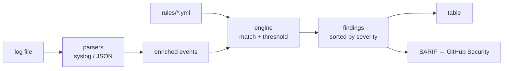

# siglint

[](https://github.com/a0merr/siglint/actions/workflows/ci.yml)


**Scan logs against Sigma-style detection rules and emit SARIF** — a small, dependency-light detection engine for the blue-team side of the house. Point it at an `auth.log`, write rules in YAML, get findings on the terminal or straight into GitHub's **Security** tab.

Built by a [Sigma](https://github.com/SigmaHQ/sigma) contributor — same detection-as-code idea, shrunk to a single CLI you can run in CI.

## Demo (30 seconds)

```console
$ siglint scan examples/auth.log -r rules
5 finding(s) in examples/auth.log:

LEVEL  RULE                      COUNT  WHERE / LINE
----------------------------------------------------------------------
CRIT   suspicious_download_pipe      1  line 10
HIGH   accepted_root_login           1  line 7
HIGH   ssh_brute_force               6  203.0.113.9
MED    new_user_created              1  line 9
MED    sudo_auth_failure             1  line 8
```

## Install

```bash
pip install -e .          # from a clone
# or, once published:  pip install siglint
```

## Usage

```bash
siglint scan <logfile> -r <rules-dir> [options]

  -f, --format {auto,syslog,json}   input format (default: auto)
  -o, --output {table,sarif,json}   report format (default: table)
  --sarif-file PATH                 also write SARIF to a file
  --fail-on {none,low,medium,high,critical}
                                    exit 1 when a finding reaches this level
```

Gate a pipeline on anything high or worse:

```bash
siglint scan /var/log/auth.log -r rules --fail-on high --sarif-file results.sarif
```

## Writing a rule

Rules are YAML, Sigma-flavored. Field keys take an operator after a pipe
(`equals` is the default): `contains`, `startswith`, `endswith`, `regex`.
Add a `threshold` to fire only after N matches, grouped by a field.

```yaml
title: SSH Brute Force
id: ssh_brute_force
level: high
description: Many failed SSH password attempts from a single source IP.
logsource: auth
detection:
  selection:
    message|contains: "Failed password"
  threshold:
    count: 5
    group_by: src_ip
  condition: selection
```

The parser enriches each event with `src_ip` and `user` pulled from the
message, so rules can match those fields across syslog and JSON logs alike.

## How it works



- **parsers** — line → field dict; extracts `src_ip` / `user`
- **rules** — YAML loader with a small selection/threshold schema
- **engine** — field operators and per-group threshold counting
- **sarif** — SARIF 2.1.0 so findings show up in the Security tab

## Rules included

| Rule | Level | What it catches |
|------|-------|-----------------|
| `ssh_brute_force` | high | 5+ failed SSH logins from one IP |
| `accepted_root_login` | high | successful interactive root login |
| `suspicious_download_pipe_shell` | critical | `curl … \| sh` dropper pattern |
| `sudo_auth_failure` | medium | failed sudo / privesc probing |
| `new_user_created` | medium | new account added (persistence) |

## GitHub Action

The CI workflow runs siglint on the sample log and uploads the SARIF with
`github/codeql-action/upload-sarif`, so detections land in the repo's Security
tab. Point it at your own logs the same way.

## Develop

```bash
pip install -e ".[dev]"
pytest -q
```

## License

MIT — see [LICENSE](LICENSE).
